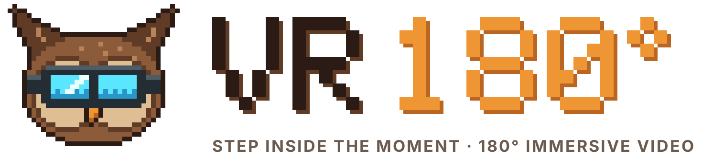

<div align="center">

<a href="https://github.com/mrg171674-sys/vr180-player">
  <picture>
    <source media="(prefers-color-scheme: dark)" srcset=".github/assets/banner-dark.png">
    <source media="(prefers-color-scheme: light)" srcset=".github/assets/banner.png">
    
  </picture>
</a>

<h3>A desktop player and converter for VR180, 360° and 3D video, built for Windows</h3>

<p>
  <a href="https://github.com/mrg171674-sys/vr180-player/releases/latest"></a>
  <a href="#-quick-start"></a>
  <a href="#-features"></a>
  <a href="https://ko-fi.com/nonscripsickle"></a>
</p>

<p>
  
  
  
  
  
  
</p>

<p>
  <a href="#-features"><b>Features</b></a> ·
  <a href="#-quick-start"><b>Quick start</b></a> ·
  <a href="#-usage"><b>Usage</b></a> ·
  <a href="#%EF%B8%8F-keyboard-shortcuts"><b>Shortcuts</b></a> ·
  <a href="#-build-from-source"><b>Build</b></a> ·
  <a href="#-tech-stack"><b>Tech stack</b></a> ·
  <a href="#-support-the-project"><b>Support</b></a>
</p>

</div>

---


**VR180 Player** plays 180×180 fisheye and equirectangular video as real VR, converts camera footage into standard VR180 files, and gives you the tools around it: a library, an editor, colour looks, a phone player and local-network watch parties.

It figures out what kind of file you opened (projection and stereo layout) on its own, renders it live on the GPU, and can send it to a PC headset, a phone, or a flat 16:9 video for sharing. Optional AI add-ons for subtitles, upscaling and 2D → 3D run entirely on your own PC.

> [!NOTE]
> Windows is the only build target right now. The app ships as an installer (with auto-update) and as a portable `.exe`.

<br clear="right">

## 📑 Contents

- [✨ Features](#-features)
  - [Watch](#watch)
  - [Convert & export](#convert--export)
  - [Edit & organise](#edit--organise)
  - [Share](#share)
  - [Local AI add-ons](#local-ai-add-ons-optional)
- [🎞️ Supported media](#%EF%B8%8F-supported-media)
- [🚀 Quick start](#-quick-start)
- [🧭 Usage](#-usage)
- [⌨️ Keyboard shortcuts](#%EF%B8%8F-keyboard-shortcuts)
- [🛠️ Build from source](#%EF%B8%8F-build-from-source)
- [🧪 Tests](#-tests)
- [🧱 Tech stack](#-tech-stack)
- [📁 Project structure](#-project-structure)
- [🔒 Privacy](#-privacy)
- [💛 Support the project](#-support-the-project)
- [📄 License](#-license)

## ✨ Features

### Watch

- **Live VR rendering on the GPU.** A fragment shader maps every view direction to the video, so fisheye → VR180, 360° playback, per-eye calibration, anaglyph 3D and picture adjustments all happen in real time.
- **Headset playback over WebXR**, with a floating in-headset control panel (seek bar, buttons, "up next") aimed with the controllers' laser pointers.
- **Several ways to view on a flat screen:** drag-to-look VR, flat, red/cyan 3D and side-by-side L|R preview.
- **Spatial audio** for first-order ambisonic (AmbiX) videos, rotated against where you look and rendered with HRTF so sounds stay put when you turn.
- **Subtitles** from sidecar `.srt` / `.vtt` files or tracks inside the video, shown as an overlay on the desktop and a floating panel in VR.
- **Comfort and control:** IPD and per-eye calibration, automatic stereo alignment, horizon auto-level, A-B loop, chapters, snapshots, sleep timer, picture-in-picture and slideshows.
- **Xbox / PlayStation controller support** and fully remappable keyboard shortcuts, plus a <kbd>Ctrl</kbd>+<kbd>K</kbd> command palette.

### Convert & export

- **Convert to VR180** in H.264 or H.265, at the original size or up to 8K side-by-side, with optional stabilisation.
- **Writes Google Spherical Video V2 metadata** so the result is recognised as 180° equirectangular VR180, the same boxes Google's Spatial Media Metadata Injector writes.
- **Hardware encoding** with NVIDIA NVENC, AMD AMF or Intel Quick Sync, each tested once so a missing GPU never breaks an export. CPU encoding is always available.
- **"No re-encode" mode** for equirect videos (keeps the original picture, very fast), and a **"Test 10 seconds first"** button to check settings and estimate time.
- **Make a flat video:** cut a normal 16:9 video out of VR180 or 360° footage, with the camera fixed or following a path you record just by watching.
- **Background job queue** that keeps converting while you watch.

### Edit & organise

- **Editor** to join clips and cut sections out, then export through the same pipeline.
- **Highlight reel** that scores each second by motion and loudness and keeps the best moments, no AI needed.
- **Library** that scans local folders, mapped drives and network shares, with cover thumbnails, automatic tags (camera, date, format, resolution, length), ratings and watch history.
- **Duplicate finder** for exact copies, near-identical clips, and fisheye originals already converted.
- **Camera / memory-card import** that notices a card going in, copies only what's new into dated folders, and verifies every copy without ever changing the card.
- **Colour looks** from `.cube` LUT files, built-in looks and saved picture presets.
- **Private vault** protected by a PIN (stored only as a salted scrypt hash).
- **Settings backup** to a single `.vr180backup` file.

### Share

- **Phone player:** stream the open video to phones on the same network over HTTPS via a QR code, with an optional PIN and per-device approval. It also works in a standalone headset's browser.
- **Watch Together** on the local network: rooms are announced automatically, and guests can join with a short invite code.

### Local AI add-ons (optional)

Nothing is downloaded until you ask for it in **Settings**, and every file is checked against a pinned SHA-256.

- **Speech to subtitles** with whisper.cpp (99 languages, optional translation to English).
- **AI upscaling** with Real-ESRGAN on the graphics card.
- **2D → 3D** with Depth Anything V2 Small over WebGPU, so flat videos and photos get real depth in the headset, live or as an exported 3D video.

## 🎞️ Supported media

| | Supported |
| --- | --- |
| **Projections** | 180° fisheye · 180° equirectangular · 360° equirectangular · flat |
| **Stereo layouts** | 2D (mono) · side-by-side (SBS) · top-bottom (TB) |
| **Video files** | `.mp4` `.mov` `.m4v` `.mkv` `.webm` |
| **Photos** | JPEG / PNG / WebP, plus Google VR180 and Cardboard Camera `.vr.jpg` (right eye extracted from XMP) |
| **Audio** | Multiple audio tracks, first-order ambisonics (AmbiX), background music for photos and silent videos |
| **Export** | H.264 / H.265 VR180 with spherical metadata, flat 16:9 reframes |

Format detection uses, in order: spherical metadata, filename hints, a few tiny decoded frames, then the frame's shape.

## 🚀 Quick start

1. Go to the [**Releases**](https://github.com/mrg171674-sys/vr180-player/releases/latest) page.
2. Download one of:
   - `VR180-Player-Setup-<version>.exe` (installer, updates itself automatically from GitHub Releases), or
   - `VR180-Player-Portable-<version>.exe` (no install; can't update itself).
3. Run it and drop a video onto the window. A short guided tour runs on first launch; you can replay it from **Settings › About**.

> [!TIP]
> The installer registers VR180 Player as a viewer for `.mp4`, `.mov`, `.m4v`, `.mkv`, `.webm` and `.vr.jpg`, so you can open files straight from Explorer.

## 🧭 Usage

The app is organised into tabs along the title bar:

| Tab | What it's for |
| --- | --- |
| **Player** | Watch, look around, switch view modes, open the Convert dialog, subtitles and audio. |
| **Library** | Browse your folders, tags, ratings, duplicates, batch conversion and card import. |
| **Calibrate** | Per-eye alignment, IPD, picture adjustments, colour looks and presets. |
| **Together** | Host or join a Watch Together room on your network. |
| **Phone player** | Start a private stream, show the QR code, set a PIN and manage devices. |
| **Settings** | Themes, shortcuts, controller mapping, AI add-ons, backup and updates. |

## ⌨️ Keyboard shortcuts

A selection of the defaults. Press <kbd>Ctrl</kbd>+<kbd>K</kbd> then <kbd>?</kbd> in the app to see them all, or remap them in **Settings**.

| Action | Keys | Action | Keys |
| --- | --- | --- | --- |
| Play / pause | <kbd>Space</kbd> / <kbd>K</kbd> | Cycle VR / flat / 3D / L\|R | <kbd>V</kbd> |
| Back / forward | <kbd>←</kbd> <kbd>J</kbd> / <kbd>→</kbd> | Reset view | <kbd>R</kbd> |
| Volume | <kbd>↑</kbd> / <kbd>↓</kbd> | Zoom in / out | <kbd>+</kbd> / <kbd>-</kbd> |
| Mute | <kbd>M</kbd> | A-B loop | <kbd>Shift</kbd>+<kbd>A</kbd> |
| Fullscreen | <kbd>F</kbd> / <kbd>F11</kbd> | Add chapter | <kbd>B</kbd> |
| Next / previous video | <kbd>N</kbd> / <kbd>P</kbd> | Previous / next chapter | <kbd>[</kbd> / <kbd>]</kbd> |
| Snapshot | <kbd>S</kbd> | Subtitles & audio menu | <kbd>C</kbd> |
| IPD − / + | <kbd>,</kbd> / <kbd>.</kbd> | Subtitles earlier / later | <kbd>G</kbd> / <kbd>H</kbd> |

## 🛠️ Build from source

**Requirements:** Windows, [Node.js](https://nodejs.org/) with npm, and Git.

```bash
git clone https://github.com/mrg171674-sys/vr180-player.git
cd vr180-player
npm install
npm start
```

| Script | What it does |
| --- | --- |
| `npm start` | Run the app in development with Electron. |
| `npm run dist` | Build the NSIS installer and portable `.exe` into `dist/` (no publishing). |
| `npm run release` | Build and publish to GitHub Releases. |
| `npm run icons` | Regenerate the app icons. |

> [!IMPORTANT]
> NSIS can't handle very long folder paths. If the build fails, copy the project (without `dist` and `test-videos`) to a short folder such as `C:\vr180`, run `npm run dist` there and copy `dist` back.

## 🧪 Tests

Run from the project folder, always with a test profile (`VR180_PROFILE`) so your own settings are never touched.

```bash
# UI suites (Electron)
CLIP=GOPR0042.mp4 VR180_PROFILE=test STEPS_FILE=scripts/tests/steps_regress.json \
  node_modules/.bin/electron scripts/tests/selftest.js

# Node suites
node scripts/tests/t_phone.js
node scripts/tests/t_import.js
node scripts/tests/t_together.js .
```

See [`scripts/tests/README.md`](scripts/tests/README.md) for fixtures and suite-specific notes.

## 🧱 Tech stack

| Area | Built with |
| --- | --- |
| App shell | [Electron](https://www.electronjs.org/) 33, packaged with [electron-builder](https://www.electron.build/) |
| Rendering | [three.js](https://threejs.org/) + custom GLSL shaders, WebXR for headsets |
| Video | [FFmpeg](https://ffmpeg.org/) via `ffmpeg-static` (incl. the `v360` filter), GPU encoders |
| AI (optional) | [ONNX Runtime Web](https://onnxruntime.ai/) (WebGPU), whisper.cpp, Real-ESRGAN |
| Phone player | Built-in HTTPS server, `node-forge` / `selfsigned` certificates, `qrcode` |
| Updates | `electron-updater` with GitHub Releases |
| UI | Plain ES modules, HTML and CSS — no front-end framework |

## 📁 Project structure

```text
vr180-player/
├── main.js            # Electron main process: windows, IPC, file handling
├── preload.js         # Safe bridge between the main process and the UI
├── lib/               # Back-end modules: ffmpeg, export queue, library, phone server,
│                      #   Watch Together, AI jobs, metadata injection, updater…
├── renderer/          # The app UI: player, VR view, library, editor, settings, themes…
├── phone/             # Page served to phones by the phone player
└── scripts/           # Icon generation and test suites
```

## 🔒 Privacy

- AI add-ons run entirely on your PC; no video, audio or text is ever uploaded.
- The phone stream is reachable only with its secret link, optionally behind a PIN and per-device approval. Its certificate authority is name-constrained to private network addresses and `localhost`.
- Automatic tags ignore location data, and bug-report summaries replace personal folder names with `~`.

## 💛 Support the project

<a href="https://ko-fi.com/nonscripsickle"></a>

If VR180 Player is useful to you, you can support its development on Ko-fi. Bug reports, ideas and pull requests are welcome too.

<a href="https://ko-fi.com/nonscripsickle"></a>
<a href="https://github.com/mrg171674-sys/vr180-player/issues"></a>

<br clear="left">

## 📄 License

Released under the MIT License, as declared in [`package.json`](package.json).

<div align="center">
<br>
<sub>Made with 🦉 for people who want to step inside the moment.</sub>
</div>
